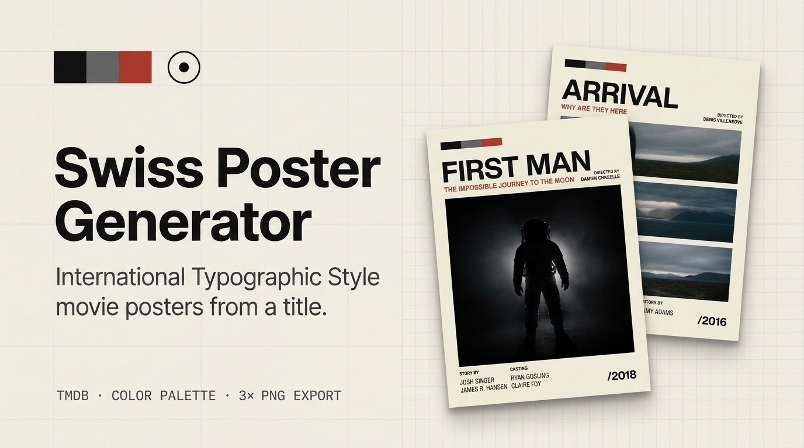

<div align="center"><strong>Swiss Poster Generator</strong></div>
<div align="center">Generate International Typographic Style posters for movies and TV shows.<br />One title, automatic TMDB metadata, high-resolution PNG export.</div>
<br />
<div align="center">

[](https://react.dev/)
[](https://www.typescriptlang.org/)
[](https://vite.dev/)
[](https://tailwindcss.com/)
[](https://opensource.org/licenses/MIT)

</div>
<div align="center">
<a href="https://github.com/Ruan-Azeredo/poster-generetor">GitHub</a>
<span> · </span>
<a href="https://github.com/Ruan-Azeredo/poster-generetor/issues">Issues</a>
<span> · </span>
<a href="https://github.com/Ruan-Azeredo/poster-generetor/pulls">Pull Requests</a>
</div>

## Introduction

A focused web studio for designing Swiss-style movie and TV posters, written in TypeScript and React. Type any title, pull verified credits and artwork from the TMDB API, extract a 3-color palette directly from your chosen imagery, fine-tune framing in a live crop editor, and export a crisp `2700 × 3600 px` PNG ready for print or sharing.

## Why

Swiss typographic movie posters look effortless, yet assembling one by hand in Figma or Illustrator means repeating the same tedious choreography every time: hunting down directors, writers, and cast lists, fitting long titles into a strict grid, sampling dominant colors, cropping frames without distorting aspect ratios, and exporting at print-ready resolution.

Swiss Poster Generator turns that workflow into a few seconds of iteration. The grid, typography scale, blend modes, and export pipeline stay locked to the International Typographic Style so you can focus on the visual composition.

## Features

- **TMDB search for movies and TV:** queries `/search/multi` and resolves title, tagline (falling back to original title), release year, directors, writers/creators, and top-billed cast (up to 10 names distributed across 4 columns).
- **Two composition modes:**
  - **Single image (default):** one large central artwork frame.
  - **3 horizontal images:** three stacked horizontal frames separated by proportional whitespace, ideal for triptychs and cinematic stills.
- **Flexible image sources:** toggle automatic TMDB artwork import (poster/backdrop for single mode, widescreen backdrop gallery for 3-image mode) or switch to custom URLs and local file uploads per frame.
- **Interactive crop & zoom editor:** drag the full image continuously behind a masked frame locked to the exact poster aspect ratio, zoom from `1.0x` to `3.0x` without stretching, and preview subtle rule-of-thirds guides while adjusting.
- **Automatic color palette:** extracts 3 dominant swatches from the active image (or blends dominant colors across all 3 frames) via `colorthief`, with a Swiss neutral fallback (`#111111`, `#646464`, `#B23A2E`).
- **Print-ready PNG export:** renders the `900 × 1200 px` poster canvas at `3×` pixel density (`2700 × 3600 px`) using `html-to-image` after waiting for fonts to settle.

## Getting started

### Prerequisites

- [Node.js](https://nodejs.org/) (LTS recommended)
- [pnpm](https://pnpm.io/)
- A free [TMDB API v3 key](https://www.themoviedb.org/settings/api)

### Install and run

Clone the repository and install dependencies:

```sh
git clone https://github.com/Ruan-Azeredo/poster-generetor.git
cd poster-generetor
pnpm install
```

Create a `.env` file in the project root with your TMDB API key:

```env
VITE_TMDB_API_KEY=your_tmdb_api_key_here
```

Start the local development server:

```sh
pnpm dev
```

Open the URL printed in your terminal (by default `http://localhost:5173`), search for a movie or series, pick **Single image** or **3 images**, adjust the framing, and click **Exportar PNG**.

## Architecture

A small, modular codebase typed end to end.

- [src/App.tsx](https://github.com/Ruan-Azeredo/poster-generetor/blob/main/src/App.tsx) — control panel state, layout switching, poster composition, and PNG export
- [src/components/ImageCropEditor.tsx](https://github.com/Ruan-Azeredo/poster-generetor/blob/main/src/components/ImageCropEditor.tsx) — unified pointer-driven pan and zoom cropper with dimmed mask
- [src/components/PosterImageFrame.tsx](https://github.com/Ruan-Azeredo/poster-generetor/blob/main/src/components/PosterImageFrame.tsx) — distortion-free image frame synced with the cropper transform
- [src/services/movieApi.ts](https://github.com/Ruan-Azeredo/poster-generetor/blob/main/src/services/movieApi.ts) — TMDB v3 client for movie/TV metadata, credits, and backdrop galleries
- [src/utils/colorExtraction.ts](https://github.com/Ruan-Azeredo/poster-generetor/blob/main/src/utils/colorExtraction.ts) — single and multi-image 3-color palette extraction via `colorthief`
- [src/utils/imageLayout.ts](https://github.com/Ruan-Azeredo/poster-generetor/blob/main/src/utils/imageLayout.ts) — aspect-preserving cover sizing shared by the poster and crop editor
- [src/types/movie.ts](https://github.com/Ruan-Azeredo/poster-generetor/blob/main/src/types/movie.ts) — core domain interfaces (`PosterMovieData`, `PosterImageMode`, `PosterImageTransform`)

## Capabilities

| Capability | Single image | 3 horizontal images |
| --- | --- | --- |
| TMDB auto-import | Poster / Backdrop | Up to 3 Backdrops / Posters |
| Custom URL & local upload | Supported | Supported (per frame) |
| Interactive pan & zoom (`1.0x`–`3.0x`) | Supported | Supported (per frame) |
| Automatic 3-swatch palette | From image | Combined across frames |
| High-res PNG export (`2700 × 3600 px`) | Supported | Supported |

> [!NOTE]
> External image URLs must allow CORS (`Access-Control-Allow-Origin`) for client-side palette extraction and PNG export. If a remote host blocks CORS, use local file upload or TMDB import instead.

## Development workflow

1. **Install dependencies:** `pnpm install`
2. **Run in development mode:** `pnpm dev`
3. **Type-check and build for production:** `pnpm build`
4. **Preview the production bundle:** `pnpm preview`
5. **Lint the codebase:** `pnpm lint`

## Contributing

Contributions are welcome — whether it's a new poster layout variation, typography refinement, localization option, or bug fix.

1. Fork the repository and create a branch from `main` (`git checkout -b feat/my-feature`).
2. Keep changes focused and ensure `pnpm build` and `pnpm lint` pass without warnings.
3. Open a pull request describing what changed and why (screenshots or exported poster examples are always appreciated).

Found a bug or have an idea for a new layout? [Open an issue](https://github.com/Ruan-Azeredo/poster-generetor/issues/new).

---

Maintained by [Ruan Azeredo](https://github.com/Ruan-Azeredo), open source under the MIT License.
